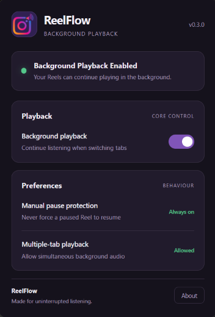

# ReelFlow

**Keep Instagram Reels playing in the background on Firefox.**

ReelFlow is a lightweight Firefox extension designed to let Instagram Reels continue playing when you switch tabs or minimize your browser.

No unnecessary features. No complicated interface. Just uninterrupted listening.

## Features

- **Background Playback:** Keep Instagram Reels playing when switching tabs.
- **Minimized Browser Support:** Continue listening while Firefox is minimized.
- **Simple Controls:** Enable or disable background playback through the extension popup.
- **Persistent Preferences:** Your playback preference is saved across browser sessions.
- **Multiple-Tab Playback:** Multiple Instagram tabs can play simultaneously.
- **Minimal Interface:** A clean, dark-themed interface with straightforward controls.

## Compatibility

- Browser: Mozilla Firefox
- Platform: Firefox desktop
- Website: Instagram Web
- Manifest: Version 3

Chromium-based browsers are not currently supported.

## Installation

### Temporary installation (development)

1. Download or clone this repository.
2. Open Firefox.
3. Navigate to `about:debugging#/runtime/this-firefox`.
4. Select **Load Temporary Add-on**.
5. Select the `manifest.json` file inside the project folder.
6. Open Instagram and refresh the page.
7. Click the ReelFlow toolbar icon to access its controls.

**Note:** Temporary extensions are removed when Firefox closes. This installation method is intended for development and testing.

A permanent installation will be provided through Mozilla Add-ons once the extension is published.

## How it works

ReelFlow uses the Page Visibility API to prevent Instagram from treating its page as hidden when Firefox switches tabs or minimizes.

The extension uses separate isolated and page-level scripts to communicate settings and manage visibility behaviour.

It does not automatically scroll Reels or call `video.play()` to force playback.

## Privacy

ReelFlow is designed to operate locally in the browser.

- No Instagram login credentials are collected.
- No external analytics services are integrated.
- No external application server is required.
- Playback preferences are stored using Firefox's local extension storage.

See the project's privacy policy for further details.

## Development

| Version | Milestone |
|---|---|
| v0.2.0 | Initial background playback implementation |
| v0.3.0 | UI redesign, accessibility and error handling |
| v0.4.0 | Reliability improvements and engine diagnostics |
| v1.0.0 | Planned public release |

## Known limitations

- Instagram may change its internal playback or visibility behaviour.
- Background playback is not guaranteed to work with every future Instagram update.
- Browser and operating-system audio restrictions may affect playback.
- The project currently targets Firefox desktop only.

## Contributing

Bug reports, compatibility feedback and suggestions are welcome.

Please include your Firefox version, operating system and steps to reproduce any reported issue.

## License

ReelFlow is licensed under the **Mozilla Public License 2.0 (MPL-2.0)**.

You are free to use, modify and distribute the project in accordance with the licence terms.

See the [LICENSE](LICENSE) file for the complete licence text.

## Distribution

ReelFlow is intended to be distributed through:

- [Mozilla Add-ons](https://addons.mozilla.org/) — official installation and automatic extension updates.
- [GitHub Releases](https://github.com/Shreyash216/ReelFlow/releases) — release notes, source code and downloadable release assets.

ReelFlow currently supports Mozilla Firefox desktop only.
---

**ReelFlow**  
Built to make Instagram listening more convenient.

## Screenshots

### Extension Popup

